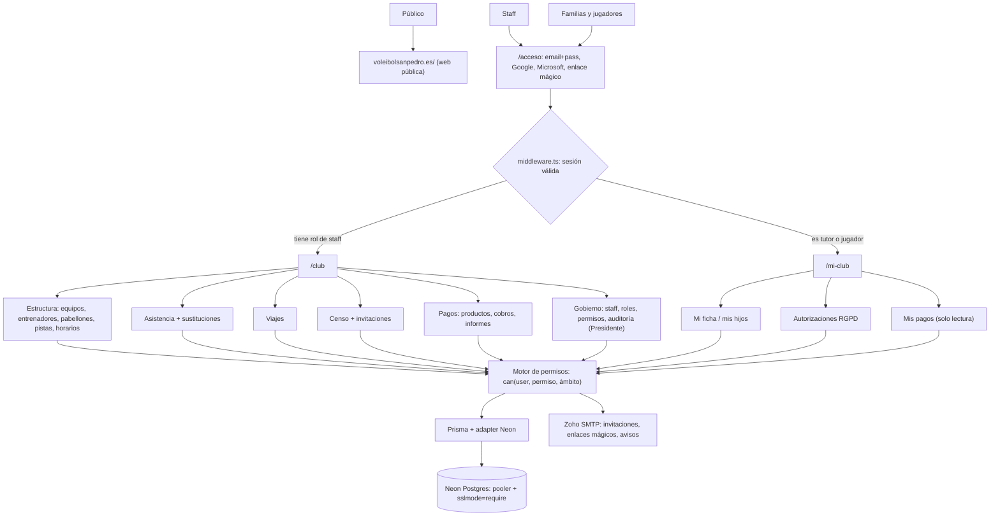
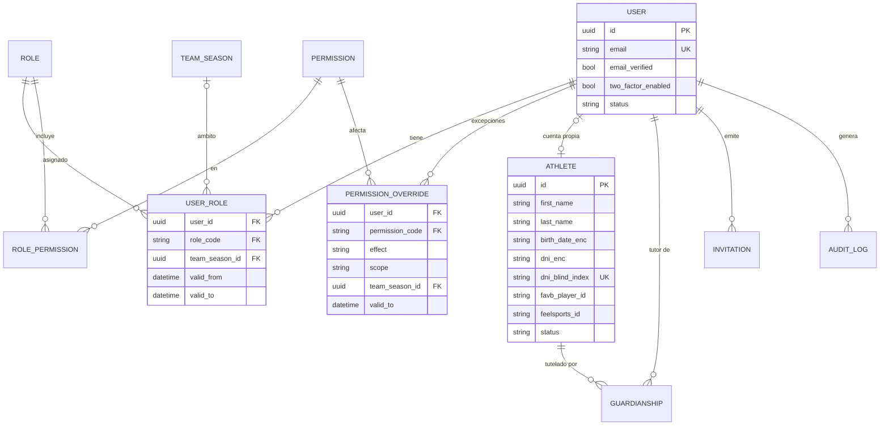
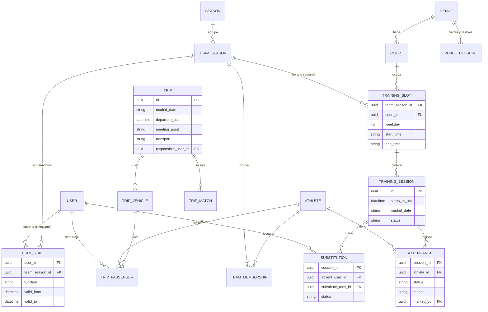
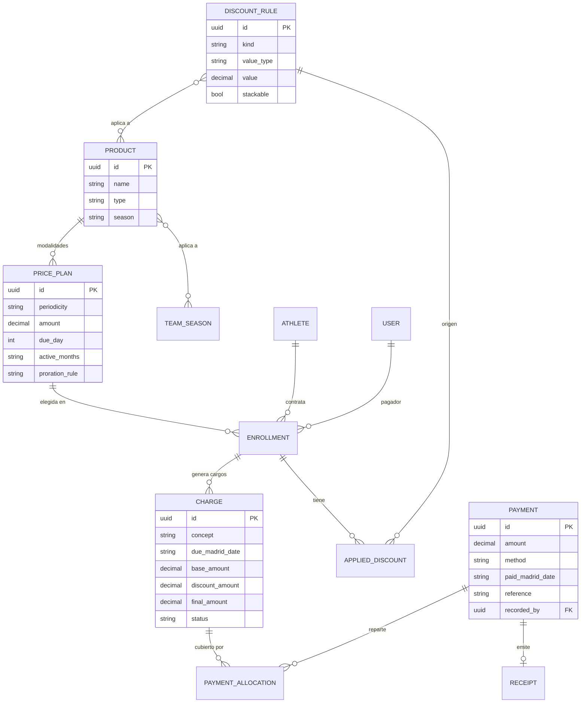
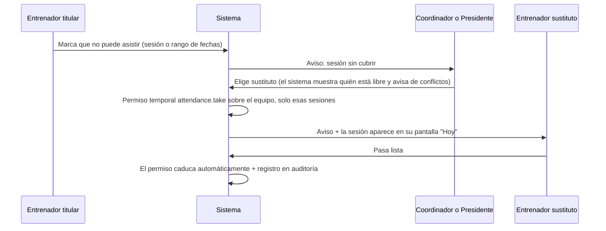
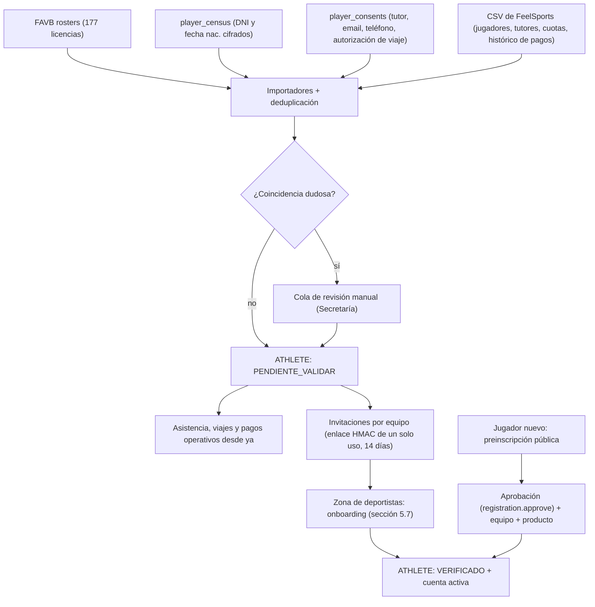
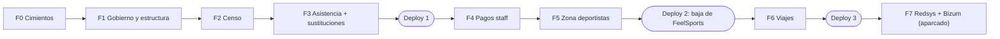

# Plan v2: intranet del club en voleibolsanpedro.es

**Rama de trabajo:** `feature/intranet-club`, creada desde `main` (`a4639c6`). **Estado:** plan aprobado en lo esencial; no hay desarrollo iniciado.

## Decisiones ya cerradas

| Tema | Decisión |
| :--- | :--- |
| Ubicación | Misma app Next.js: `/club` para el staff y `/mi-club` para deportistas y familias |
| Capa de datos | **Prisma** + driver adapter de Neon (pooler, `sslmode=require`), adaptando el esquema de la rama de pagos con roles N:M |
| FeelSports | **Se abandona.** Su funcionalidad (inscripción, cuotas, consulta de pagos) se integra en la web. Ya está pedido el export CSV |
| Staff | Se da de alta y se asigna a equipos **desde la propia aplicación** |
| Asistencia | **Solo para el staff.** Jugadores y familias no la ven. Los 5 estados propuestos quedan aprobados |
| RGPD | Las autorizaciones se firman y renuevan dentro de la **zona de deportistas** |
| Pagos | **Entran en el alcance sin pasarela:** gestión completa para el staff y consulta en solo lectura para familias y jugadores |
| Pasarela | **Aparcada** hasta tener Redsys + Bizum. La rama `implement_payment_gateway_system` queda solo como referencia |

---

## 1. Autenticación: respuestas y decisión

**¿Qué aporta la opción (c), Neon Auth (Managed Better Auth)?** Es el mismo Better Auth, pero alojado y gestionado por Neon:

- ✅ No hay que mantener el código del servidor de autenticación. Los usuarios se guardan en tu BD (esquema `neon_auth`).
- ✅ **Autenticación por branch:** cada branch de Neon tiene sus propios usuarios, lo que es muy cómodo para el desarrollo local.
- ✅ Incluido en el plan gratuito hasta 60.000 usuarios activos al mes.
- ❌ **Todavía no tiene 2FA/MFA** (su roadmap lo marca como *coming soon*), ni permite personalizar el plugin de admin, ni usar *hooks* o plugins propios.

**¿Se puede usar OAuth (Google, Hotmail)?** Sí, con las opciones (a) y (c). Google funciona directamente. Hotmail, Outlook y Live son cuentas personales de Microsoft, y entran con el proveedor Microsoft (tenant `common`). Solo hay que registrar una app en Google Cloud y otra en Microsoft Entra, ambas gratuitas, con *callbacks* para `voleibolsanpedro.es` y `localhost:3000`.

**¿El staff tendrá usuario y contraseña?** Sí, y no es exclusivo de la opción (a): las tres opciones admiten email + contraseña. Lo que hace imprescindible la (a) es el **2FA**, que quiero obligatorio para Presidente y Tesorería porque gestionan dinero y datos de menores. También hacen falta *hooks* propios para impedir altas sin invitación.

### Decisión: (a) Better Auth autoalojado, con tablas en Neon

| Perfil | Métodos de acceso |
| :--- | :--- |
| Staff | Email + contraseña, con **2FA obligatorio** (TOTP) para Presidente y Tesorería y recomendado para el resto. Puede vincular además su cuenta de Google |
| Familias y jugadores | Google, Microsoft (Hotmail/Outlook), enlace mágico por email o email + contraseña, a elección de cada uno |
| Para todos | **Sin registro abierto.** Solo se puede crear cuenta con una invitación válida. Un login de Google o Microsoft solo se vincula si su email verificado coincide con el de una invitación o un contacto ya registrado |

> [!NOTE]
> Hay que comprobar en F0 que la versión actual de Better Auth es compatible con Next 14.2. Si exige Next 15, la actualización afecta a toda la web pública y se validaría completa en local antes de seguir.

---

## 2. Arquitectura

---

## 3. Gobierno: Presidente, roles y permisos

### 3.1 El rol Presidente

- **Hay uno solo.** Lo garantiza un índice único parcial en BD. Tiene **todos los permisos de forma implícita** y nadie se los puede revocar.
- **Facultades exclusivas, que no se pueden delegar:**
  - Crear, editar y desactivar perfiles de staff.
  - Asignar o revocar roles y permisos individuales.
  - Asignar o quitar equipos a cada entrenador. **Un entrenador puede tener varios equipos**, como principal o como ayudante.
  - Transferir la presidencia.
  - Exportar masivamente datos personales.
- **Transferencia de presidencia:** el Presidente designa a su sucesor, que la acepta con 2FA. El anterior pasa a `DIRECTIVO`.
- **Acceso de emergencia:** el usuario actual por variables de entorno (`ADMIN_USER`) se conserva **solo** para recuperar la presidencia si se pierde el acceso. Queda auditado y no sirve para el uso diario.

> [!NOTE]
> He interpretado "asignar o desasignar **clubes** a cada entrenador" como **equipos**. Si te referías a otra cosa, por ejemplo clubes filiales o convenios, dímelo.

### 3.2 Modelo de permisos

- **Permisos granulares** con el formato `modulo.accion` y un **ámbito**: `GLOBAL` (todo el club), `EQUIPO` (los equipos asignados) o `PROPIO` (lo suyo).
- **Roles = plantillas** de permisos. Una persona puede tener varios roles (por ejemplo, entrenador y tutor).
- **Excepciones por usuario:** el Presidente puede **conceder o quitar** un permiso concreto a una persona concreta, por encima de lo que diga su rol.
- **Asignaciones temporales** con `valid_from`/`valid_to`: sustituciones, delegados de un viaje, ayudas puntuales. Caducan solas.
- Toda concesión, revocación y uso de un permiso sensible queda en `AUDIT_LOG`.

### 3.3 Roles (plantillas)

| Rol | Para quién |
| :--- | :--- |
| `PRESIDENTE` | Control total y facultades exclusivas (único) |
| `DIRECTIVO` | Vicepresidencia y vocales: consulta general, sin datos sensibles salvo concesión expresa |
| `COORDINADOR` | Dirección técnica: todos los equipos, horarios, sustituciones, viajes |
| `TESORERIA` | Pagos, productos, descuentos, informes económicos |
| `SECRETARIA` | Censo, fichas, documentación, RGPD, comunicaciones |
| `ENTRENADOR` | Sus equipos: asistencia, fichas básicas, contacto de emergencia |
| `AYUDANTE` | Como entrenador, sin editar asistencias pasadas ni cancelar sesiones |
| `DELEGADO` | Logística de equipo: viajes, convocatorias y apoyo en la asistencia |
| `TUTOR` | Zona de deportistas: sus hijos |
| `JUGADOR` | Zona de deportistas: lo propio (desde 14 años) |

### 3.4 Catálogo de permisos

Leyenda: 🔒 exclusivo del Presidente · ✅ incluido por defecto en el rol · ⚙️ el Presidente puede concederlo · — no aplica. Ámbito: G = global, E = equipo, P = propio.

| Módulo | Permiso | Ámbito | Directivo | Coord. | Tesor. | Secret. | Entren. | Ayud. | Deleg. |
| :--- | :--- | :---: | :---: | :---: | :---: | :---: | :---: | :---: | :---: |
| **Gobierno** | `staff.manage` crear o desactivar staff | G | 🔒 | 🔒 | 🔒 | 🔒 | 🔒 | 🔒 | 🔒 |
| | `permissions.manage` roles y permisos | G | 🔒 | 🔒 | 🔒 | 🔒 | 🔒 | 🔒 | 🔒 |
| | `team.assign_staff` asignar equipos a entrenadores | G | 🔒 | 🔒 | 🔒 | 🔒 | 🔒 | 🔒 | 🔒 |
| | `data.bulk_export` exportación masiva de datos personales | G | 🔒 | 🔒 | 🔒 | 🔒 | 🔒 | 🔒 | 🔒 |
| | `audit.view` ver auditoría | G | ⚙️ | — | — | ⚙️ | — | — | — |
| **Estructura** | `season.manage` temporadas y equipos | G | — | ⚙️ | — | — | — | — | — |
| | `venue.manage` pabellones y pistas | G | — | ✅ | — | — | — | — | — |
| | `schedule.manage` horarios de entrenamiento | G | — | ✅ | — | — | — | — | — |
| | `schedule.propose` proponer un cambio de horario | E | — | — | — | — | ✅ | — | — |
| **Asistencia** | `attendance.take` pasar lista | E | — | ✅ (G) | — | — | ✅ | ✅ | ⚙️ |
| | `attendance.edit_past` editar pasadas 48 h | E | — | ✅ (G) | — | — | ⚙️ | — | — |
| | `session.manage` cancelar o crear una sesión extra | E | — | ✅ (G) | — | — | ✅ | — | — |
| | `attendance.reports` informes | E | ✅ (G) | ✅ (G) | — | — | ✅ | ✅ | — |
| **Sustituciones** | `substitution.request` avisar de una no disponibilidad | P | — | ✅ | — | — | ✅ | ✅ | — |
| | `substitution.assign` asignar sustituto | G | — | ✅ | — | — | — | — | — |
| **Viajes** | `trip.manage` planificar viajes | G | — | ✅ | — | — | ⚙️ | — | ✅ (E) |
| | `trip.assign_people` asignar responsables y conductores | G | — | ✅ | — | — | — | — | ⚙️ |
| | `trip.view` ver viajes | E | ✅ (G) | ✅ (G) | — | — | ✅ | ✅ | ✅ |
| **Censo** | `athlete.view_basic` ficha básica | E | ✅ (G) | ✅ (G) | ✅ (G) | ✅ (G) | ✅ | ✅ | ✅ |
| | `athlete.view_emergency` alergias + contacto de emergencia | E | — | ✅ (G) | — | ✅ (G) | ✅ | ✅ | ✅ |
| | `athlete.view_sensitive` DNI completo y salud (auditado) | G | — | — | — | ⚙️ | — | — | — |
| | `athlete.edit` editar fichas | G | — | — | — | ✅ | — | — | — |
| | `athlete.import` importadores y deduplicación | G | — | — | — | ✅ | — | — | — |
| | `athlete.deactivate` dar de baja | G | — | — | — | ✅ | — | — | — |
| | `invitation.send` invitar a familias o jugadores | E | — | ✅ (G) | — | ✅ (G) | ✅ | — | — |
| | `registration.approve` aprobar preinscripciones | G | — | ⚙️ | — | ✅ | — | — | — |
| **RGPD** | `consent.view_status` quién puede salir en fotos | E | ✅ (G) | ✅ (G) | — | ✅ (G) | ✅ | ✅ | ✅ |
| | `consent.manage` firma presencial, revocación, PDF | G | — | — | — | ✅ | — | — | — |
| **Pagos** | `payments.view` ver estado de cuotas y cobros | G | ⚙️ | — | ✅ | — | — | — | — |
| | `payments.record` registrar un cobro manual | G | — | — | ✅ | — | — | — | — |
| | `payments.void` anular, devolver o condonar (doble confirmación) | G | — | — | ✅ | — | — | — | — |
| | `products.manage` productos, modalidades y precios | G | — | — | ✅ | — | — | — | — |
| | `discounts.manage` definir descuentos | G | — | — | ✅ | — | — | — | — |
| | `discounts.apply` aplicar un descuento a un deportista | G | — | — | ✅ | — | — | — | — |
| | `payments.reports` informes y exportación | G | ⚙️ | — | ✅ | — | — | — | — |
| | `payments.team_status` semáforo de cuota de sus jugadores | E | — | ⚙️ | — | — | ⚙️ | — | — |
| **Comunicación** | `comms.team` email a las familias de su equipo | E | — | ✅ (G) | — | ✅ (G) | ✅ | — | ✅ |
| | `comms.all` email a todo el club | G | ⚙️ | — | — | ✅ | — | — | — |
| **Web pública** | `web.streaming` directos y grabaciones | G | ⚙️ | — | — | ⚙️ | — | — | — |
| | `web.favb_sync` forzar la sincronización con la FAVB | G | — | ⚙️ | — | — | — | — | — |

**Otros casos que he tratado como permisos:**

- **Editar asistencias pasadas:** pasadas 48 h, solo con `attendance.edit_past`, para evitar que se retoquen informes.
- **Jugadores que doblan:** el entrenador ve la ficha básica de un jugador de otro equipo mientras esté añadido como invitado a su sesión.
- **Datos de salud:** solo con concesión expresa y siempre auditados. El entrenador ve únicamente alergias y contacto de emergencia.
- **Semáforo de cuotas para entrenadores:** desactivado por defecto; es una decisión del club si se activa.
- **Doble confirmación** (reintroducir la contraseña o 2FA) para anular cobros, condonar deudas, transferir la presidencia y exportar datos.
- **Fuera del alcance actual:** "ver como" otro usuario (suplantación en solo lectura). Se puede añadir más adelante como 🔒, siempre auditado.

---

## 4. Modelo de datos

### 4.1 Identidad y permisos

### 4.2 Deportivo: estructura, asistencia, sustituciones y viajes

### 4.3 Pagos (sin pasarela)

---

## 5. Módulos funcionales

### 5.1 Estructura deportiva: equipos, entrenadores, pabellones y pistas

- **Temporadas y equipos:** la temporada 26/27 se carga con los 13 equipos FAVB y los de AFADE. Al cerrar una temporada, la siguiente se crea clonando la estructura.
- **Asignación de entrenadores (🔒 Presidente):** cada entrenador puede llevar N equipos, como principal o como ayudante, con fechas de vigencia. El Presidente crea el perfil de staff, y el sistema envía la invitación por email; al aceptarla, la persona define su contraseña y activa el 2FA. También se puede importar la lista de staff por CSV cuando la tengáis.
- **Pabellones y pistas:** cada pabellón tiene su dirección y enlace a Maps; las pistas pueden ser pista 1, pista 2, central o media pista.
- **Horarios:** franjas semanales por equipo y pista. Incluye:
  - **detección de conflictos** (misma pista a la misma hora),
  - **cierres** (festivos locales de Marbella y San Pedro, pabellón cerrado),
  - **vista de ocupación semanal** por pabellón, que también muestra los partidos en casa sacados de la FAVB.

### 5.2 Asistencia (solo staff)

- **5 estados:** `PRESENTE` · `RETRASO` · `FALTA_JUSTIFICADA` (lesión, enfermedad, estudios, otro) · `FALTA_INJUSTIFICADA` · `LESIONADO_ASISTE`.
- **Pantalla "Hoy" en el móvil:** muestra las sesiones de sus equipos. Todos aparecen presentes por defecto y solo se marcan las excepciones. Objetivo: menos de 30 segundos por sesión. Si en el pabellón no hay cobertura, los cambios se guardan en una cola local y se envían después.
- **Invitados:** se puede añadir a un jugador de otro equipo que entrena ese día.
- **Informes:** % de asistencia por jugador, equipo y mes, alerta configurable tras N faltas seguidas, panel del coordinador y exportación a CSV/PDF.
- **Fechas:** se guarda `starts_at_utc` + `madrid_date`, y se filtra siempre con `formatMadridDateString(...) === dateStr`.

### 5.3 Sustituciones

El Presidente o el Coordinador también pueden asignar un sustituto directamente, sin que el titular lo haya pedido.

### 5.4 Viajes (partidos fuera)

- **Origen:** los partidos fuera de casa de la FAVB (`isClubHome=false`) aparecen como **viajes pendientes de planificar**. Un mismo viaje puede agrupar varios equipos que juegan en la misma sede.
- **Datos del viaje:** hora y punto de salida, regreso estimado, transporte (coches particulares, furgoneta, autobús), vehículos con conductor y plazas, pasajeros (jugadores convocados y staff) y responsable.
- **Comprobaciones:** aviso o bloqueo si viaja un **menor sin autorización de viaje** (`consent_travel` ya existe en `player_consents`), si se superan las plazas de un vehículo o si un conductor tiene otro compromiso a esa hora.
- **Aviso a las familias:** se envía por email con los datos del viaje. En el futuro, también podría verse en `/mi-club` (opcional).
- **Coste (opcional):** el viaje se puede cobrar como producto puntual del módulo de pagos.

### 5.5 Censo de deportistas

**Estrategia:** el censo se **pre-rellena** con lo que ya tiene el club, y las familias lo **validan** desde la zona de deportistas.

- **Deduplicación:** la clave principal es el *blind index* del DNI. Si no hay DNI, se usa nombre normalizado + fecha de nacimiento + email del tutor. Los casos dudosos pasan a la cola de revisión de Secretaría.
- **Ficha mínima:**
  - nombre,
  - fecha de nacimiento (cifrada),
  - DNI (obligatorio desde 14 años; cifrado + *blind index*),
  - nº de licencia,
  - equipos de la temporada,
  - tutores,
  - contacto de emergencia,
  - alergias (opcional; dato de salud, cifrado y auditado),
  - talla de equipación (opcional).

### 5.6 Pagos: parte del staff

| Bloque | Funcionalidad |
| :--- | :--- |
| **Productos** | Cuota de temporada, matrícula, licencia federativa, equipación o material, viajes, torneos o campus, seguro. Cada producto es **recurrente** o **puntual**, pertenece a una temporada y se aplica a categorías o equipos |
| **Modalidades de pago** | **Mensual**, **trimestral**, **anual** (pago único) o **plazos a medida**. Para cada una se define importe, día de vencimiento, meses activos (sep–may), regla de **prorrateo** para altas a mitad de temporada y fianza o matrícula previa |
| **Descuentos** | 2º y 3º hermano, pago anual anticipado, familia numerosa, beca (% o importe), hijos de staff, manual con motivo. Se define si se pueden **acumular**, un tope máximo y si exigen justificación |
| **Métodos de pago** | Efectivo, transferencia (IBAN del club + concepto automático por deportista), **domiciliación SEPA** (mandato firmado, IBAN cifrado), Bizum manual, TPV físico. *Redsys online y Bizum online, aparcados* |
| **Inscripción** | Al inscribir a un deportista en un producto y una modalidad se elige el **pagador** (tutor o jugador adulto) y se **generan los cargos** con sus vencimientos |
| **Cobros** | Registro manual: importe, método, fecha, referencia y quién lo registra. Permite **pagos parciales**, que un pago cubra varios cargos, devoluciones y condonaciones (`payments.void`, con doble confirmación) |
| **Estados del cargo** | `PENDIENTE` · `PARCIAL` · `PAGADO` · `VENCIDO` (calculado con la fecha de Madrid) · `CONDONADO` · `ANULADO` |
| **Recibos** | PDF numerado por serie anual, reutilizando el generador de la rama de pagos |
| **Informes** | Recaudado frente a previsto por mes, **morosidad por antigüedad** (0–30, 31–60, más de 60 días), desglose por equipo, producto y método, coste de los descuentos concedidos, listado de deudores y cierre de temporada. Todo exportable a CSV/PDF |
| **Importación FeelSports** | Planes, cargos y **histórico de pagos** del CSV, marcados con origen `FEELSPORTS` |
| **Avisos (opcional)** | Email automático X días antes y después del vencimiento, mediante una función programada de Netlify |
| **Remesas SEPA (fase posterior)** | Generación del XML `pain.008` para presentarlo en el banco |

### 5.7 Zona de deportistas `/mi-club`

- **Onboarding**, en un solo paso:
  1. La familia abre el enlace de invitación.
  2. Verifica la identidad con el año de nacimiento y los últimos 5 caracteres del DNI.
  3. Revisa y completa la ficha.
  4. **Firma las autorizaciones RGPD de la temporada** (el flujo actual de `/autorizaciones` se integra aquí).
  5. Crea la cuenta con Google, Microsoft, enlace mágico o contraseña.
- **Mi ficha / mis hijos:** una cuenta de tutor ve a todos sus hijos, y un menor puede tener dos tutores vinculados.
- **Autorizaciones:** estado actual, descarga del PDF firmado y renovación anual.
- **Mis pagos (solo lectura):**
  - estado general (al corriente, pendiente o vencido),
  - cargos y vencimientos,
  - pagos realizados,
  - **descarga de recibos**,
  - instrucciones de pago (IBAN y concepto).
- **Reglas de edad:**
  - Menores de 14: la cuenta es del tutor.
  - De 14 a 17: el menor puede tener cuenta propia y el tutor sigue vinculado.
  - Desde 18: cuenta propia.
- **No se muestra** la asistencia (decisión cerrada).
- **Navbar:** el enlace "Portal Jugador@s (FeelSports)" se sustituye por "Acceso socios" → `/acceso`.

---

## 6. Seguridad y RGPD

- **Contraseñas y sesiones:** contraseñas con Argon2id o bcrypt, gestionadas por Better Auth. Las sesiones se guardan en BD y se pueden revocar; cookie `HttpOnly`, `Secure` y `SameSite=Lax`.
- **2FA:** obligatorio para `PRESIDENTE` y `TESORERIA`.
- **Altas:** solo por invitación. OAuth se vincula únicamente si el email verificado coincide.
- **Rate limiting persistente** en Neon. El actual, en memoria, no funciona en lambdas.
- **Comprobación en el servidor** de `can(user, permiso, ámbito)` en cada Server Action y ruta API, no solo en la interfaz.
- **Cifrado AES-256** (ya implementado) para DNI, fecha de nacimiento, salud e IBAN SEPA.
- **Secretos:** solo en `process.env` y en las variables de entorno de Netlify, sin valores por defecto en el código (*fail-closed*).
- **Auditoría** de accesos a datos sensibles, cambios de permisos, cobros, anulaciones y exportaciones.
- **Documentación legal:** actualizar la política de privacidad y el registro de actividades de tratamiento (añadiendo pagos y viajes), un compromiso de confidencialidad para el staff y una política de conservación de datos.
- **Desarrollo:** un **branch `dev` de Neon** para no trabajar en local con datos reales de menores.

---

## 7. Hoja de ruta

| Fase | Entregables | Tamaño |
| :--- | :--- | :---: |
| **F0 Cimientos** | Prisma + adapter Neon, branch `dev` de Neon, migraciones; Better Auth (email+pass, Google, Microsoft, enlace mágico, 2FA); motor de permisos (roles, excepciones, temporales, ámbitos); alta del Presidente inicial; `/acceso`, layout `/club`, `middleware`, auditoría, rate limit persistente; comprobación de compatibilidad con Next 14 | M |
| **F1 Gobierno y estructura** | Interfaz del Presidente (staff por invitación, roles, permisos, excepciones), temporadas y equipos (semilla FAVB/AFADE), asignación de entrenadores a N equipos, pabellones, pistas, horarios, cierres, conflictos y vista de ocupación | M |
| **F2 Censo** | Importadores FAVB, `player_census` y `player_consents`; importador del CSV de FeelSports (jugadores y tutores); deduplicación y cola de revisión; fichas, bajas, invitaciones | M |
| **F3 Asistencia + sustituciones** | Pantalla "Hoy" en móvil, 5 estados, invitados, cancelaciones y sesiones extra, informes y alertas, flujo de sustituciones con permiso temporal | M |
| **→ Deploy 1** | F0 a F3, tras pasar el checklist de 5 puntos | 15 cr. |
| **F4 Pagos staff** | Productos, modalidades, descuentos, métodos, inscripciones y cargos, cobros manuales, recibos PDF, informes, importación del histórico de FeelSports | L |
| **F5 Zona deportistas** | Onboarding con RGPD integrado, mis hijos, mis pagos en solo lectura, recibos, panel de la campaña por equipo, sustitución del enlace a FeelSports | M |
| **→ Deploy 2** | F4 + F5. **Con esto ya se puede prescindir de FeelSports** | 15 cr. |
| **F6 Viajes** | Viajes desde partidos fuera, vehículos y plazas, pasajeros, comprobación de autorizaciones de viaje, avisos a familias | M |
| **→ Deploy 3** | F6 | 15 cr. |
| **F7 Pasarela** | Redsys + Bizum, tomando como referencia la rama `implement_payment_gateway_system` (aparcado hasta tu aviso) | L |
| **Futuro** | Convocatorias, comunicaciones masivas, material y equipación, documentación (reconocimientos médicos), lesiones, remesas SEPA | — |

> [!IMPORTANT]
> Todo se desarrolla en `feature/intranet-club` y se valida en `localhost:3000` contra el branch `dev` de Neon. **Ningún push ni deploy sin tu aprobación expresa.** Si el calendario lo permite, se pueden juntar los deploys 2 y 3.

---

## 8. Decisiones pendientes (menores; no bloquean F0)

1. **"Clubes" = equipos:** ¿lo confirmas?
2. **Facultades exclusivas:** propongo que solo sean 🔒 la gestión de staff, los permisos, la asignación de equipos, la transferencia de presidencia y la exportación masiva. Horarios, viajes y sustituciones serían delegables (por defecto al Coordinador). ¿Lo ves bien, o también deben ser exclusivos del Presidente?
3. **Pagos para jugadores de 14 a 17 años:** ¿solo los ve el tutor pagador *(recomendado)* o también el menor?
4. **Métodos de pago que usáis hoy:** ¿hay domiciliaciones SEPA activas? ¿Bizum a un teléfono del club? El CSV de FeelSports lo aclarará.
5. **Descuentos reales** (hermanos, pago anual…): se sacarán del CSV de FeelSports o me los pasas tú.
6. **Semáforo de cuotas para entrenadores:** ¿desactivado por defecto *(recomendado)*?
7. **Avisos automáticos de vencimiento por email:** ¿sí o no?
8. **Viajes:** ¿se cobran como producto? ¿Las familias verán los detalles en `/mi-club` o basta con el email?
