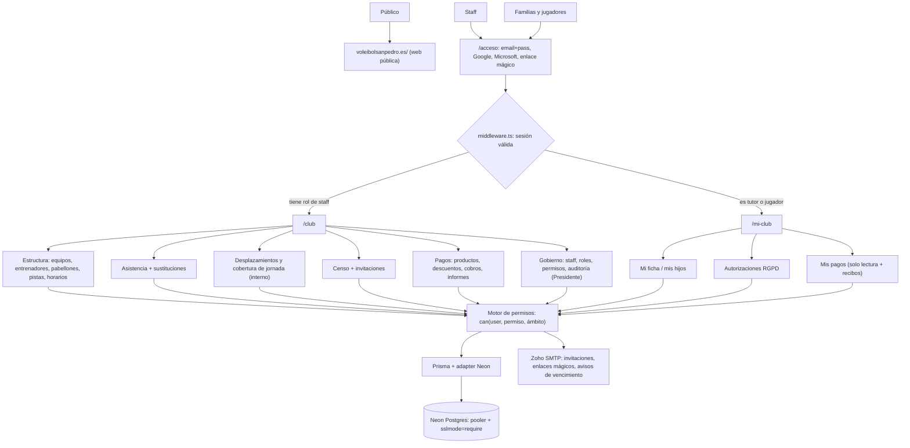
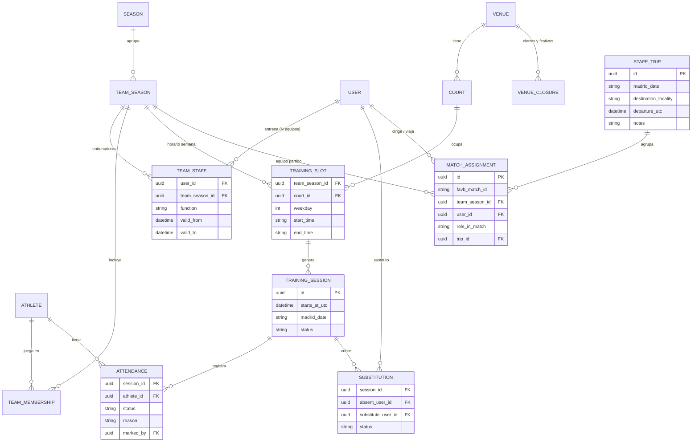
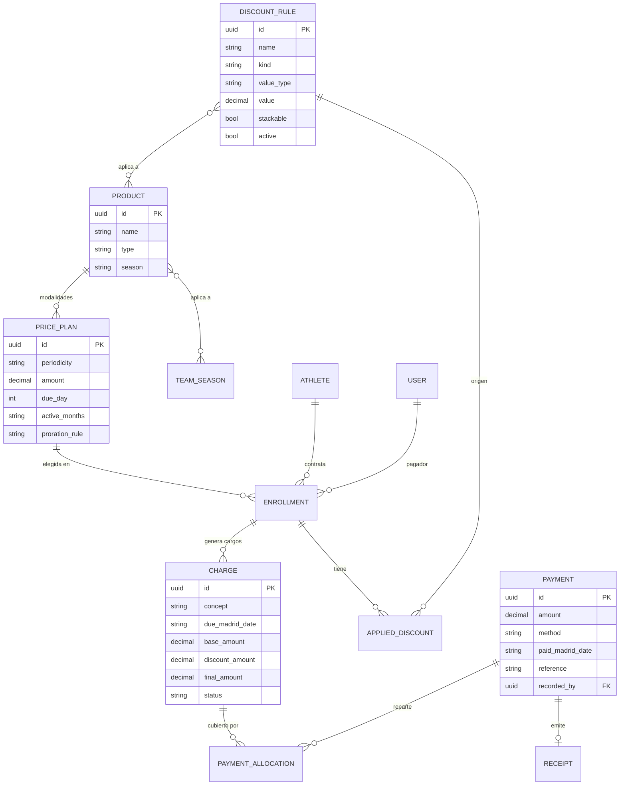
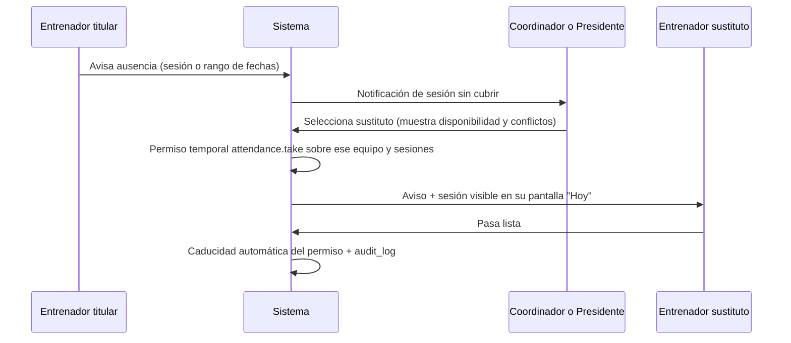
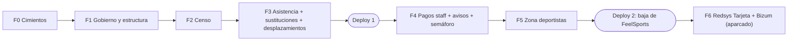

# Plan definitivo (v3): intranet del club en voleibolsanpedro.es

**Rama de trabajo:** `feature/intranet-club` (creada desde `main` `a4639c6`).  
**Estado:** Todas las decisiones cerradas y plan listo para aplicar. Sin desarrollo iniciado.

---

## Decisiones cerradas

| Tema | Decisión final |
| :--- | :--- |
| Ubicación | Misma app Next.js: `/club` (staff) y `/mi-club` (deportistas y familias) |
| Capa de datos | **Prisma** + driver adapter de Neon (`-pooler`, `sslmode=require`), adaptando el esquema de la rama de pagos con roles N:M |
| Autenticación | **Better Auth autoalojado** en Neon: email + contraseña, Google, Microsoft (Hotmail/Outlook/Live), enlace mágico y 2FA (obligatorio en Presidente y Tesorería). **Sin registro abierto** (solo por invitación) |
| Rol Presidente | **Único** en BD, con control total para crear staff, asignar varios equipos a cada entrenador y **decidir qué permisos da o revoca** a cada rol o usuario |
| FeelSports | **Se abandona.** Su funcionalidad se integra en la web (CSV pedido para migración inicial) |
| Staff | Alta y asignación a uno o varios equipos **desde la propia aplicación** |
| Asistencia | **Solo para el staff.** Jugadores y familias no la ven. 5 estados aprobados |
| Viajes / Desplazamientos | **Solo a nivel interno del staff:** asignar qué entrenadores viajan y dirigen cada equipo cada jornada, coordinar desplazamientos y detectar conflictos horarios |
| RGPD | Autorizaciones integradas en el onboarding de `/mi-club` |
| Pagos (fase actual) | Gestión completa para el staff (productos, modalidades, descuentos **configurables desde el panel**, cobros manuales, recibos PDF, informes) + **avisos automáticos de vencimiento por email** |
| Semáforo de cuotas | **Activado por defecto para entrenadores**, para ver de un vistazo el estado de pagos de sus jugadores (sin importes ni datos bancarios) |
| Zona deportistas (pagos) | Consulta en **solo lectura** para tutores y también para **jugadores de 14 a 17 años** (sin impacto legal mientras el cobro/contrato recaiga en el tutor) |
| Pasarela (F7) | **Redsys Tarjeta + Redsys Bizum** (ligado a la cuenta bancaria del club, sin teléfono manual). Aparcada hasta disponer del TPV virtual |

---

## 1. Arquitectura

> [!NOTE]
> En F0 se verificará la compatibilidad de la versión actual de Better Auth con Next.js 14.2. Si exigiera Next 15, la actualización se validaría completa en local sobre toda la web pública antes de continuar.

---

## 2. Gobierno: Presidente, roles y permisos

### 2.1 El rol Presidente

- **Hay uno solo.** Garantizado por índice único parcial en BD. Tiene todos los permisos implícitos y nadie puede revocárselos.
- **Facultades de gobierno (exclusivas):**
  - Crear, editar y desactivar perfiles de staff.
  - **Decidir libremente qué permisos da o quita**, tanto editando las plantillas de cada rol como aplicando excepciones individuales por usuario.
  - Asignar o desasignar **equipos** a cada entrenador (**un entrenador puede llevar varios equipos**, como primer entrenador o ayudante).
  - Transferir la presidencia (el sucesor acepta con 2FA; el anterior pasa a `DIRECTIVO`).
  - Exportar masivamente datos personales.
- **Acceso de emergencia:** el usuario por variables de entorno (`ADMIN_USER`) se mantiene únicamente como acceso de recuperación si se pierde la cuenta del Presidente, quedando registrado en auditoría.

### 2.2 Motor de permisos

- **Permisos granulares** `modulo.accion` con **ámbito**: `GLOBAL` (todo el club), `EQUIPO` (equipos asignados) o `PROPIO` (lo suyo).
- **Roles = plantillas configurables** por el Presidente. Una persona puede acumular varios roles (por ejemplo, `ENTRENADOR` + `TUTOR` + `DIRECTIVO`).
- **Excepciones por usuario (`ALLOW` / `DENY`):** el Presidente puede conceder o denegar permisos concretos a cualquier persona por encima de su rol.
- **Asignaciones temporales** con `valid_from` / `valid_to`: sustituciones de entrenadores o coberturas puntuales de jornada que caducan solas.
- Toda concesión, revocación y uso de un permiso sensible queda en `AUDIT_LOG`.

### 2.3 Roles (plantillas iniciales)

| Rol | Para quién |
| :--- | :--- |
| `PRESIDENTE` | Control total y único |
| `DIRECTIVO` | Vicepresidencia y vocales: consulta general; permisos ampliables por el Presidente |
| `COORDINADOR` | Dirección técnica: todos los equipos, horarios, sustituciones, desplazamientos de entrenadores |
| `TESORERIA` | Pagos, productos, descuentos configurables, cobros manuales, informes económicos |
| `SECRETARIA` | Censo, fichas, documentación, RGPD, comunicaciones |
| `ENTRENADOR` | Sus equipos: asistencia, fichas básicas, contacto de emergencia, **semáforo de cuotas**, sus desplazamientos |
| `AYUDANTE` | Como entrenador, sin editar asistencias pasadas ni cancelar sesiones |
| `DELEGADO` | Apoyo logístico de equipo en jornadas y asistencia |
| `TUTOR` | Zona de deportistas (`/mi-club`): sus hijos (ficha, RGPD, pagos en solo lectura) |
| `JUGADOR` | Zona de deportistas (`/mi-club`): su propia ficha, RGPD y estado de cuotas en solo lectura (desde 14 años) |

### 2.4 Catálogo de permisos

Leyenda: 🔒 exclusivo del Presidente · ✅ activado por defecto en la plantilla · ⚙️ configurable por el Presidente · — no incluido por defecto. Ámbito: G = global, E = equipo, P = propio.

| Módulo | Permiso | Ámbito | Directivo | Coord. | Tesor. | Secret. | Entren. | Ayud. | Deleg. |
| :--- | :--- | :---: | :---: | :---: | :---: | :---: | :---: | :---: | :---: |
| **Gobierno** | `staff.manage` crear o desactivar staff | G | 🔒 | 🔒 | 🔒 | 🔒 | 🔒 | 🔒 | 🔒 |
| | `permissions.manage` gestionar roles y permisos | G | 🔒 | 🔒 | 🔒 | 🔒 | 🔒 | 🔒 | 🔒 |
| | `team.assign_staff` asignar equipos a entrenadores | G | 🔒 | 🔒 | 🔒 | 🔒 | 🔒 | 🔒 | 🔒 |
| | `data.bulk_export` exportación masiva de datos | G | 🔒 | 🔒 | 🔒 | 🔒 | 🔒 | 🔒 | 🔒 |
| | `audit.view` ver registro de auditoría | G | ⚙️ | — | — | ⚙️ | — | — | — |
| **Estructura** | `season.manage` temporadas y equipos | G | — | ⚙️ | — | — | — | — | — |
| | `venue.manage` pabellones y pistas | G | — | ✅ | — | — | — | — | — |
| | `schedule.manage` horarios de entrenamiento | G | — | ✅ | — | — | — | — | — |
| | `schedule.propose` proponer cambio de horario | E | — | — | — | — | ✅ | — | — |
| **Asistencia** | `attendance.take` pasar lista | E | — | ✅ (G) | — | — | ✅ | ✅ | ⚙️ |
| | `attendance.edit_past` editar pasadas 48 h | E | — | ✅ (G) | — | — | ⚙️ | — | — |
| | `session.manage` cancelar o crear sesión extra | E | — | ✅ (G) | — | — | ✅ | — | — |
| | `attendance.reports` informes de asistencia | E | ✅ (G) | ✅ (G) | — | — | ✅ | ✅ | — |
| **Sustituciones** | `substitution.request` avisar de ausencia propia | P | — | ✅ | — | — | ✅ | ✅ | — |
| | `substitution.assign` asignar sustituto | G | — | ✅ | — | — | — | — | — |
| **Desplazamientos** | `trip.manage` asignar entrenadores a partidos/jornada | G | — | ✅ | — | — | — | — | — |
| | `trip.view` ver cuadrante de desplazamientos | G / E | ✅ (G) | ✅ (G) | — | — | ✅ (E/propios) | ✅ (E/propios) | ✅ (E) |
| **Censo** | `athlete.view_basic` ficha básica | E | ✅ (G) | ✅ (G) | ✅ (G) | ✅ (G) | ✅ | ✅ | ✅ |
| | `athlete.view_emergency` alergias + contacto emergencia | E | — | ✅ (G) | — | ✅ (G) | ✅ | ✅ | ✅ |
| | `athlete.view_sensitive` DNI completo y salud (auditado) | G | — | — | — | ⚙️ | — | — | — |
| | `athlete.edit` editar fichas | G | — | — | — | ✅ | — | — | — |
| | `athlete.import` importadores y deduplicación | G | — | — | — | ✅ | — | — | — |
| | `athlete.deactivate` dar de baja | G | — | — | — | ✅ | — | — | — |
| | `invitation.send` invitar a familias o jugadores | E | — | ✅ (G) | — | ✅ (G) | ✅ | — | — |
| | `registration.approve` aprobar preinscripciones | G | — | ⚙️ | — | ✅ | — | — | — |
| **RGPD** | `consent.view_status` quién puede salir en fotos | E | ✅ (G) | ✅ (G) | — | ✅ (G) | ✅ | ✅ | ✅ |
| | `consent.manage` firma presencial, revocación, PDF | G | — | — | — | ✅ | — | — | — |
| **Pagos** | `payments.view` ver estado detallado de cuotas y cobros | G | ⚙️ | — | ✅ | — | — | — | — |
| | `payments.record` registrar cobro manual | G | — | — | ✅ | — | — | — | — |
| | `payments.void` anular, devolver o condonar (doble conf.) | G | — | — | ✅ | — | — | — | — |
| | `products.manage` productos, modalidades y precios | G | — | — | ✅ | — | — | — | — |
| | `discounts.manage` configurar reglas de descuento | G | — | — | ✅ | — | — | — | — |
| | `discounts.apply` aplicar descuento a un deportista | G | — | — | ✅ | — | — | — | — |
| | `payments.reports` informes y exportación | G | ⚙️ | — | ✅ | — | — | — | — |
| | `payments.team_status` **semáforo de cuotas** de su equipo | E | — | ✅ (G) | — | — | ✅ | ⚙️ | — |
| **Comunicación** | `comms.team` email a familias de su equipo | E | — | ✅ (G) | — | ✅ (G) | ✅ | — | ✅ |
| | `comms.all` email a todo el club | G | ⚙️ | — | — | ✅ | — | — | — |
| **Web pública** | `web.streaming` directos y grabaciones | G | ⚙️ | — | — | ⚙️ | — | — | — |
| | `web.favb_sync` forzar sincronización FAVB | G | — | ⚙️ | — | — | — | — | — |

---

## 3. Modelo de datos

### 3.1 Identidad y permisos

### 3.2 Deportivo: estructura, asistencia, sustituciones y desplazamientos de staff

### 3.3 Pagos (configuración, cobros y pasarela por fases)

---

## 4. Módulos funcionales

### 4.1 Estructura deportiva: equipos, entrenadores, pabellones y pistas

- **Temporadas y equipos:** carga inicial con los 13 equipos FAVB + AFADE. Clonado rápido al abrir nueva temporada.
- **Asignación de entrenadores (🔒 Presidente):** alta de perfil de staff desde la web (o importación CSV), envío automático de invitación por email para definir contraseña y 2FA, y asignación a uno o varios equipos (primer entrenador / ayudante) con vigencia.
- **Pabellones y pistas:** pistas configurables (pista 1, pista 2, central, media pista), detección automática de solapamientos horarios, cierres/festivos y vista semanal de ocupación integrada con los partidos en casa de la FAVB.

### 4.2 Asistencia (solo staff)

- **5 estados:** `PRESENTE` · `RETRASO` · `FALTA_JUSTIFICADA` (lesión, enfermedad, estudios, otro) · `FALTA_INJUSTIFICADA` · `LESIONADO_ASISTE`.
- **Pantalla "Hoy" móvil-first:** todos presentes por defecto, marcando solo excepciones (<30 s). Cola local offline si falla la cobertura en el pabellón. Invitados puntuales de otros equipos.
- **Informes:** % asistencia por jugador/equipo/mes, alerta por N faltas seguidas, panel global para Coordinador y exportación CSV/PDF.
- **Zona horaria:** `starts_at_utc` + `madrid_date` (`YYYY-MM-DD`), filtrando siempre con `formatMadridDateString(...) === dateStr`.

### 4.3 Sustituciones

### 4.4 Desplazamientos y cobertura técnica de jornada (solo interno)

- **Propósito:** organizar internamente **qué entrenador/ayudante/delegado viaja o dirige cada equipo cada jornada** (partidos fuera y en casa). No visible para familias ni ligado a productos de pago.
- **Cuadrante de jornada:** se alimenta de los partidos de `favb-data.ts` / `afade-data.ts` y permite asignar responsable técnico por partido (`MATCH_ASSIGNMENT`).
- **Detección de conflictos:** si un entrenador lleva dos equipos que juegan en la misma franja horaria o en localidades incompatibles, el cuadrante marca el conflicto en rojo para asignar un sustituto o segundo entrenador.
- **Agrupación de viajes (`STAFF_TRIP`):** agrupa partidos fuera en la misma zona/jornada para coordinar salida, hora y notas internas del cuerpo técnico.

### 4.5 Censo de deportistas

- **Semilla inicial:** `FAVB_PLAYERS` (177 licencias) + `player_census` + `player_consents` + **CSV de FeelSports**.
- **Deduplicación:** por *blind index* del DNI o, si no existe, por nombre normalizado + fecha de nacimiento + email del tutor. Los casos dudosos pasan a revisión manual de Secretaría.
- **Ciclo:** `IMPORTADO → PENDIENTE_VALIDAR → VERIFICADO → BAJA`. La asistencia y la gestión de cuotas funcionan desde el primer día aunque la familia aún no haya activado su cuenta.
- **Preinscripción (altas nuevas):** flujo público aprobado por Secretaría/Presidente con asignación directa a equipo y producto de cuota.

### 4.6 Pagos: parte del staff + avisos + pasarela por fases

| Bloque | Funcionalidad |
| :--- | :--- |
| **Productos** | Cuotas, matrícula, licencia, equipación, campus/torneos, etc. Recurrentes o puntuales, por temporada y aplicables a categorías/equipos |
| **Modalidades** | Mensual, trimestral, anual o plazos a medida: importe, día de vencimiento, meses activos y prorrateo para altas a mitad de temporada |
| **Descuentos configurables** | CRUD completo desde la web: porcentaje o importe fijo, aplicables por producto/categoría/temporada, acumulables o exclusivos, tope máximo y motivo obligatorio |
| **Métodos por fases** | **Ahora (manual):** Efectivo, Transferencia bancaria (IBAN + concepto automático), TPV físico. **Fase F7 (pasarela):** **Redsys Tarjeta + Redsys Bizum** (ligado a cuenta bancaria del club, sin teléfono manual) |
| **Cobros y cargos** | Generación automática de cargos al inscribir, pagos parciales, cobertura de varios cargos en un pago, anulación/condonación (`payments.void` con doble confirmación) |
| **Semáforo para entrenadores** | Indicador visual en la lista de su equipo (`🟢 Al corriente` · `🟡 Pendiente` · `🔴 Vencido`) sin revelar importes ni datos bancarios |
| **Avisos automáticos** | Función programada (Netlify) que envía emails de recordatorio vía Zoho SMTP X días antes del vencimiento y tras vencer |
| **Recibos e informes** | PDF numerado por serie anual; informes de recaudación vs previsto, morosidad (0-30 / 31-60 / +60 días), por equipo/producto/método y exportación CSV/PDF |
| **Histórico FeelSports** | Importación de cuotas y pagos previos del CSV marcados con origen `FEELSPORTS` |

### 4.7 Zona de deportistas `/mi-club`

- **Onboarding unificado:** enlace de invitación → verificación (año de nacimiento + últimos 5 caracteres del DNI) → revisión de ficha → **firma de autorizaciones RGPD de la temporada** → creación de cuenta (Google, Microsoft, enlace mágico o contraseña).
- **Mis fichas / mis hijos:** un tutor ve a todos sus hijos; un menor puede tener dos tutores.
- **Autorizaciones RGPD:** estado, descarga de PDF firmado y renovación anual.
- **Mis pagos (solo lectura):**
  - Visible para tutores y también para **jugadores de 14 a 17 años** (sin impacto legal: la lectura de su estado de cuota está cubierta desde los 14 años; la contratación y pago futuro recaen siempre en el tutor pagador y no se exponen datos sensibles del tutor).
  - Estado general, calendario de cargos/vencimientos, pagos realizados, descarga de recibos PDF e instrucciones de pago.
- **Sin asistencia:** el módulo de asistencia no existe en `/mi-club`.
- **Navbar:** "Portal Jugador@s (FeelSports)" pasa a "Acceso socios" → `/acceso`.

---

## 5. Seguridad y RGPD

- **Contraseñas y sesiones:** Argon2id/bcrypt vía Better Auth; sesiones revocables en BD; cookies `HttpOnly`, `Secure`, `SameSite=Lax`.
- **2FA:** obligatorio para `PRESIDENTE` y `TESORERIA`.
- **Sin registro abierto:** altas únicamente con invitación válida; vinculación OAuth condicionada a email verificado coincidente.
- **Rate limiting persistente** en Neon (sustituyendo al actual en memoria).
- **Autorización en servidor** en cada Server Action y API Route (`can(user, permiso, ámbito)`).
- **Cifrado AES-256** para DNI, fecha de nacimiento y notas médicas; secretos exclusivamente en `process.env` / Netlify Env (*fail-closed*).
- **Auditoría:** registro de accesos a datos sensibles, cambios de permisos, cobros, anulaciones y exportaciones.
- **Documentación y entorno:** actualizar política de privacidad y registro de actividades; compromiso de confidencialidad del staff; **branch `dev` en Neon** para desarrollar en local sin datos reales.

---

## 6. Hoja de ruta

| Fase | Entregables | Tamaño |
| :--- | :--- | :---: |
| **F0 Cimientos** | Prisma + adapter Neon, branch `dev` de Neon, migraciones; Better Auth (email+pass, Google, Microsoft, enlace mágico, 2FA); motor de permisos configurable; Presidente inicial; `/acceso`, layout `/club`, `middleware`, auditoría, rate limit persistente; test compatibilidad Next 14 | M |
| **F1 Gobierno y estructura** | Panel del Presidente (staff por invitación, edición de roles/permisos/excepciones, asignación de entrenadores a N equipos), temporadas/equipos, pabellones, pistas, horarios, cierres, conflictos | M |
| **F2 Censo** | Importadores FAVB, `player_census`, `player_consents` y CSV FeelSports; deduplicación y cola de revisión; CRUD fichas, bajas, invitaciones | M |
| **F3 Asistencia, sustituciones y desplazamientos** | Pantalla "Hoy" móvil (5 estados, offline, invitados), informes; flujo de sustituciones con permiso temporal; cuadrante de desplazamientos/cobertura técnica de jornada y conflictos | M-L |
| **→ Deploy 1** | F0 a F3 validados en local con checklist de 5 puntos | 15 cr. |
| **F4 Pagos staff + avisos** | Productos, modalidades, **descuentos configurables**, métodos manuales, cargos, cobros parciales, **semáforo para entrenadores**, recibos PDF, informes, importación FeelSports, **emails automáticos de vencimiento** | L |
| **F5 Zona deportistas (`/mi-club`)** | Onboarding con RGPD integrado, mis hijos, mis pagos (solo lectura, visible también para 14–17 años), recibos, panel de campaña, sustitución de FeelSports en Navbar | M |
| **→ Deploy 2** | F4 + F5. **Baja definitiva de FeelSports** | 15 cr. |
| **F6 Pasarela Redsys + Bizum** | TPV virtual Redsys (Tarjeta + Bizum ligado a cuenta del club), callbacks, conciliación automática (aparcado hasta tener el TPV) | M |

> [!IMPORTANT]
> Desarrollo íntegro en `feature/intranet-club` y validación en `localhost:3000` contra el branch `dev` de Neon. **Ningún `git push` ni deploy sin tu aprobación explícita.**
